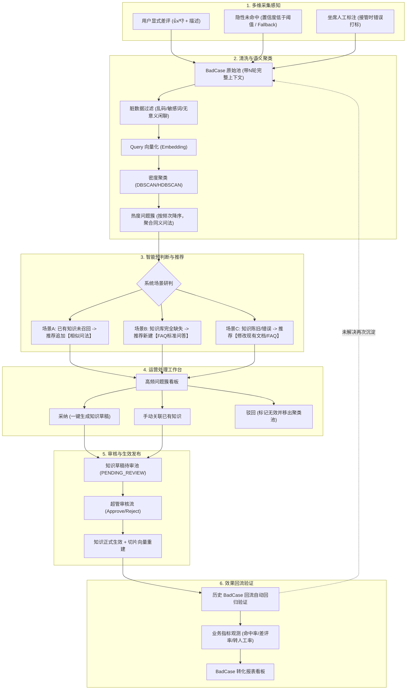
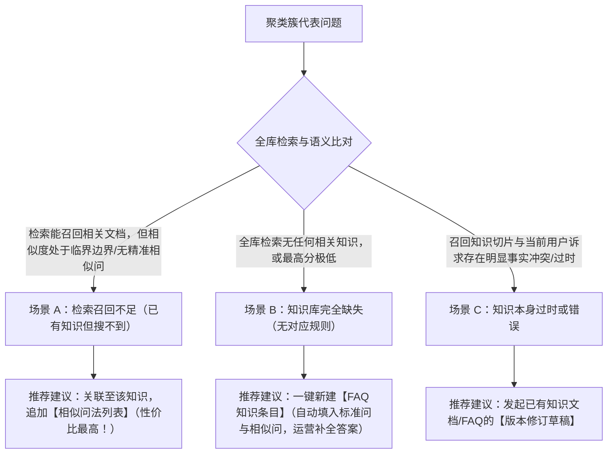
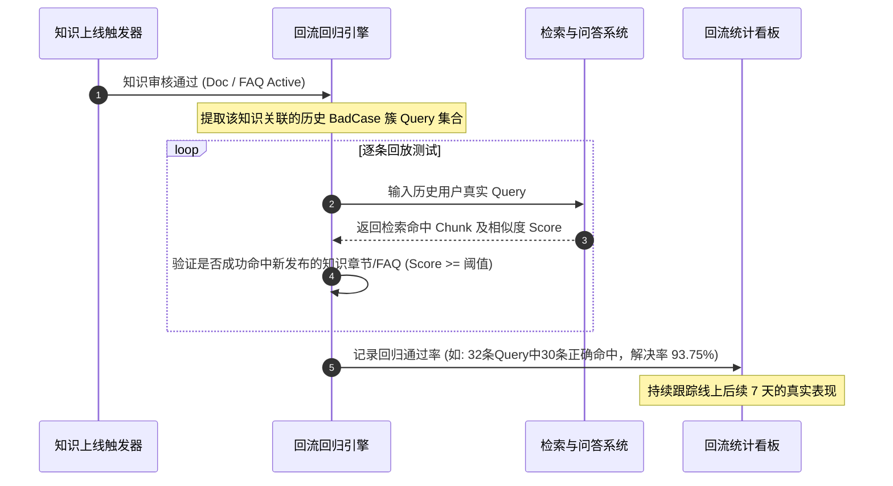

# 电商智能客服 BadCase 运营闭环体系设计方案

## 一、 方案背景与建设目标

在大模型知识库问答（RAG）系统中，单纯依赖初始知识文档无法穷尽用户千变万化的真实提问。如果缺乏一套系统化的反馈与闭环机制，系统就会陷入“用户反复吐槽、客服重复转人工、知识库长期滞后”的被动局面。

本方案针对智能客服业务场景，设计并落地一套**标准企业级 BadCase 全生命周期闭环体系**，打通从前端多源感知、中台智能聚类、运营工作台处理，到知识审核入库与效果回流评测的全链路，确保智能客服系统的问答准确率与自助解决率呈现飞轮式持续进化。

---

## 二、 完整闭环链路架构

全链路遵循 **“采集 $\rightarrow$ 清洗去重 $\rightarrow$ 语义聚类 $\rightarrow$ 规则判定 $\rightarrow$ 运营工作台处理 $\rightarrow$ 生成知识草稿 $\rightarrow$ 审核发布 $\rightarrow$ 回流验证”** 标准企业级闭环：



---

## 三、 详细步骤与功能模块设计

### 步骤 1：多维采集（覆盖三类核心来源）

#### 1. 采集来源定义
每条采集的 BadCase 必须**完整附带前置 N 轮上下文对话**，否则运营无法判定代词指代、前置意图及多轮场景根因：

| 来源分类 | 触发时机与交互规则 | 优先级 | 价值与特征 |
| :--- | :--- | :---: | :--- |
| **用户显式差评** | AI 每条回答气泡左下角常驻“满意 👍 / 不满意 👎”按钮；用户点击“不满意”后弹出反馈弹窗，可勾选或选填差评原因（如：答非所问、答错了、内容过时等）。 | **最高** | 用户痛点最直接、主观体验受损严重的硬反馈。 |
| **系统隐性未命中** | 检索召回的 Top-1 得分低于系统置信度阈值（如 Score < 0.35），或命中决策路由的 `FALLBACK` 兜底应答。 | **次高** | 自动发现潜在知识盲区，覆盖面广但噪声相对较多。 |
| **坐席人工介入标注** | 客户转人工或坐席接管会话后，坐席侧控制台显示历史 AI 回答，坐席可针对某条错误回答一键打标：`AI回答错误`、`答非所问`、`答案过时`、`缺少知识`。 | **最高质量** | 业务专家第一视角判断，判定精准且定位明确。 |

#### 2. BadCase 数据结构设计
每条 BadCase 严格按照业务库隔离，避免跨产品串库：

```sql
CREATE TABLE bad_cases (
    id VARCHAR(36) PRIMARY KEY,
    product_code VARCHAR(64) NOT NULL,            -- 归属产品/产品线(数据隔离)
    kb_id VARCHAR(36) NOT NULL,                   -- 关联知识库ID
    session_id VARCHAR(36) NOT NULL,              -- 关联会话ID
    message_id VARCHAR(36) NOT NULL,              -- 产生问题的消息ID
    case_type VARCHAR(32) NOT NULL,               -- 来源类型: USER_FEEDBACK(差评), LOW_CONFIDENCE(未命中), AGENT_LABEL(坐席标注)
    
    user_query TEXT NOT NULL,                     -- 用户原始提问
    user_feedback_comment TEXT,                   -- 用户填写的差评描述(可选)
    agent_label_category VARCHAR(32),             -- 坐席标注分类: WRONG_ANSWER, IRRELEVANT, OUTDATED, MISSING_KNOWLEDGE
    
    ai_raw_response TEXT NOT NULL,                -- 机器人当时的原始回答
    recall_sources JSON NOT NULL,                 -- 召回来源明细(切片ID、文档名、相似度得分等)
    confidence_score FLOAT DEFAULT 0.0,           -- 检索综合置信度得分
    chat_context JSON NOT NULL,                   -- 完整前置上下文(近5轮问答列表)
    
    cluster_id VARCHAR(36),                       -- 所属语义聚类簇ID
    cluster_status VARCHAR(32) DEFAULT 'PENDING', -- 聚类状态: PENDING(待聚类), CLUSTERED(已入簇), NOISE(离群噪点)
    
    status VARCHAR(32) DEFAULT 'PENDING',         -- 运营处理状态: PENDING(待处理), PROCESSING(处理中), ADOPTED(已采纳), REJECTED(驳回), STASH(暂存)
    reject_reason TEXT,                           -- 驳回理由(闲聊/敏感词/无意义输入/业务不支持)
    recommended_action VARCHAR(32),               -- 系统预判建议: ADD_SIMILAR_QUERY, CREATE_FAQ, UPDATE_DOC
    target_doc_id VARCHAR(36),                    -- 推荐/关联的目标文档或FAQ ID
    
    handled_by VARCHAR(64),                       -- 运营处理人工号
    handled_at TIMESTAMP,                         -- 处理时间
    handling_notes TEXT,                          -- 运营处理说明留痕
    created_at TIMESTAMP DEFAULT CURRENT_TIMESTAMP
);
```

---

### 步骤 2：清洗 + 语义聚类（解决高频统计痛点）

#### 1. 传统统计的反模式痛点
- **传统字符串统计的缺陷**：用户表述极其灵活，例如 `怎么退款`、`退款流程`、`我想退订单`、`东西不要了钱怎么退`，在传统统计中会被视作 4 条独立 Query，导致每个问题都只有 1 次记录，运营无法感知真正的 Top 高频盲区。
- **语义聚类解法**：通过稠密向量表示与密度聚类算法，将语义相近、意图一致的问句合并为一个高频问题簇。

#### 2. 算法与清洗执行流程
1. **数据清洗与预过滤**：
   - 过滤乱码、字符长度 $\le 2$ 的无意义字符；
   - 敏感词/辱骂词过滤；
   - 纯闲聊 Query 过滤（如“你好”、“在吗”、“吃了没”）；
2. **向量化表征（Embedding）**：
   - 调用预置的中文向量模型（`BAAI/bge-large-zh-v1.5`）对每条 BadCase 的 `user_query` 提取 1024 维密集特征向量；
3. **密度语义聚类（DBSCAN / HDBSCAN）**：
   - 设定余弦距离阈值 $\epsilon$（建议 $0.15 \sim 0.20$）与最小成簇核心样本数 $\text{min\_samples} = 3$；
   - 将同一产品库下的未处理 BadCase 进行聚类，自动划分稠密问题簇并分离离群点（Outliers）；
4. **聚类簇特征提取与聚合输出**：
   - **簇代表问（Cluster Representative Query）**：选取簇内几何质心最近的 Query，或通过轻量大模型总结出的最标准化业务问法；
   - **簇热度计数（Cluster Frequency）**：累计簇内包含的 BadCase 总件数（即高频痛点排行权重）；
   - **簇内用户真实问法列表**：保留所有被合并的不同口语化问法，作为后续生成相似问的天然数据源；
   - **输出形态**：
     > **【高频簇示例】**：簇名《怎么申请退款》（热度：38次）  
     > *包含用户真实问法*：“退款怎么弄”、“订单怎么退”、“买了能退货退钱吗”、“退款入口在哪里”、“申请退款流程是什么”...

---

### 步骤 3：自动预判断（AI 辅助运营推荐，大幅降低工作量）

语义聚类完成后，系统利用大模型与知识库相似度匹配进行自动化规则预判，为运营人员提供三种处理方案建议：



> [!IMPORTANT]
> **合规安全底线**：系统自动生成的判断与建议**仅作为待审草稿存在，绝对严禁未经人工审核直接写入正式生产知识库**！所有改动必须经由运营确认与超管审核。

---

### 步骤 4：运营 BadCase 处理工作台（产品界面交互）

工作台按**热度倒序展示问题簇**，运营人员优先聚焦解决 Top 80% 的高频热点问题。单条/单簇提供 3 种核心操作：

#### 1. 采纳（一键生成知识草稿）
- **操作逻辑**：运营确认系统推荐方案合理，点击“采纳并生成草稿”。
  - **若为场景 A（追加相似问）**：系统自动打开现有知识文档/FAQ，在草稿编辑区将该簇的所有用户口语问法自动追加到 `similar_questions` 列表中，无需运营逐字录入；
  - **若为场景 B（新增 FAQ）**：系统自动以簇代表问题作为【标准问】，簇内全量问法作为【相似问】，自动生成 FAQ 草稿框架，运营只需校对或补充权威【标准答案】；
- **流转状态**：生成的知识条目进入 `PENDING_REVIEW`（待审核）状态，BadCase 标记为 `ADOPTED`（已采纳）。

#### 2. 关联已有知识（手动修正）
- **操作逻辑**：若系统推荐的目标知识不准，运营可点击“手动关联”，在搜索弹窗中输入关键词搜索全库，选中正确的文档或 FAQ 章节，将这批 Query 绑定并追加为相似问法。

#### 3. 驳回（无效过滤池）
- **操作逻辑**：若该簇属于无效流量，运营点击“驳回”并勾选/填报理由：
  - *非业务闲聊 / 调侃测试*
  - *用户自身输入错误 / 错别字导致语义断裂*
  - *超出当前平台业务支持范围（如询问竞品业务）*
  - *恶意刷量 / 敏感违规*
- **流转状态**：该批 Case 标记为 `REJECTED` 并移出待处理池，后续聚类与推荐算法将此特征作为负样本排除，不再重复打扰运营。

---

### 步骤 5：知识草稿与审核发布流（与现有审核体系无缝衔接）

本步骤与系统现有的**文档与知识审核流**深度集成：

1. **草稿提交**：运营人员在 BadCase 工作台完成采纳与编辑后，保存并生成知识草稿，状态变更为 `PENDING_REVIEW`；
2. **超管审核中心**：超级管理员在统一审核界面查看该变更的详情、来源 BadCase 簇背景、修改差异（Diff 对比）；
3. **审核通过发布**：
   - 超管点击“审核通过”后，数据状态变为 `ACTIVE`；
   - 系统自动触发**增量/全量 Markdown 切片与向量嵌入重建（Embedding re-indexing）**；
   - 知识库版本号递增，正式对外生效。

---

### 步骤 6：效果回流验证（闭环最后一环）

许多系统只做到“发布上线”就戛然而止，无法量化新知识到底有没有真正解决历史问题。回流验证机制作为闭环的核心防线，提供自动化测试与长期指标监控：



#### 1. 自动化回归测试（即时验证）
- 在知识发布上线的瞬间，系统自动提取该知识关联的原始 BadCase 簇问句列表；
- 模拟调用检索引擎重新检索，验证检索 Top-1/Top-3 是否能稳定命中新发布的切片或 FAQ，若未命中则立即告警提醒运营排查切片粒度。

#### 2. 线上业务指标观测（中长期验证）
知识上线后持续观测该类业务的 3 项核心指标变化：
1. **同类 Query 未命中率（Low-confidence Rate）**：期望下降 $\ge 80\%$；
2. **该知识对应答案差评率（Thumbs-down Rate）**：期望降低至 $3\%$ 以下；
3. **同类会话转人工率（Escalation Rate）**：验证用户在获得标准解答后是否自主离线，降低人工座席负荷。

#### 3. BadCase 转化全景看板（报表指标）
- **转化漏斗看板**：  
  $$\text{采集总量 (Cases)} \longrightarrow \text{有效聚类簇数 (Clusters)} \longrightarrow \text{采纳生成草稿数} \longrightarrow \text{审核上线数} \longrightarrow \text{线上问题解决率提升}$$
- **典型成效案例展示**：
  > *例如*：针对【大件家具高空作业费】问题簇共沉淀 42 条差评与未命中 Case，通过工作台一键生成 FAQ 并审核发布后：
  > - 该问法回归通过率：**100%**
  > - 线上未命中率：环比下降 **84.2%**
  > - 对应场景转人工率：环比下降 **31.5%**

---

## 四、 数据库与核心数据结构方案

在现有数据架构中，新增 2 张核心表，扩展现有 `chat_messages`：

### 1. 消息表扩展字段（`chat_messages`）
在用户问答明细中记录反馈状态：
- `user_feedback`: `'UP'` / `'DOWN'` / `NULL`
- `user_feedback_comment`: 用户差评补充说明
- `agent_feedback_category`: 坐席标注类别（`WRONG_ANSWER`, `IRRELEVANT`, `OUTDATED`, `MISSING_KNOWLEDGE`）

### 2. 聚类簇汇总表（`bad_case_clusters`）
```sql
CREATE TABLE bad_case_clusters (
    id VARCHAR(36) PRIMARY KEY,
    product_code VARCHAR(64) NOT NULL,
    kb_id VARCHAR(36) NOT NULL,
    cluster_name VARCHAR(255) NOT NULL,         -- 簇代表标题(如: 怎么申请退款)
    case_count INT DEFAULT 0,                    -- 该簇聚合的 BadCase 总件数
    sample_queries JSON NOT NULL,                -- 簇内典型问法样例列表
    recommended_action VARCHAR(32),              -- 推荐方案: ADD_SIMILAR_QUERY / CREATE_FAQ / UPDATE_DOC
    target_knowledge_id VARCHAR(36),             -- 推荐关联知识ID(若有时)
    status VARCHAR(32) DEFAULT 'PENDING',        -- 状态: PENDING(待处理), RESOLVED(已解决上线), REJECTED(已驳回)
    resolved_knowledge_id VARCHAR(36),           -- 最终生成的知识文档/FAQ ID
    created_at TIMESTAMP DEFAULT CURRENT_TIMESTAMP,
    updated_at TIMESTAMP DEFAULT CURRENT_TIMESTAMP
);
```

### 3. 回流验证记录表（`bad_case_validations`）
```sql
CREATE TABLE bad_case_validations (
    id VARCHAR(36) PRIMARY KEY,
    cluster_id VARCHAR(36) NOT NULL,
    knowledge_id VARCHAR(36) NOT NULL,
    total_test_cases INT NOT NULL,              -- 回归测试样本数
    passed_cases INT NOT NULL,                  -- 回归通过数
    pass_rate FLOAT NOT NULL,                   -- 回归通过率 (如 0.9375)
    baseline_unmatched_rate FLOAT,              -- 上线前未命中率基线
    current_unmatched_rate FLOAT,               -- 上线后追踪未命中率
    improvement_rate FLOAT,                     -- 改善幅度
    validated_at TIMESTAMP DEFAULT CURRENT_TIMESTAMP
);
```

---

## 五、 后端核心 RESTful API 规划

| 模块 | 请求方式 | 路由路径 | 功能描述 | 核心入参 / 响应 |
| :--- | :---: | :--- | :--- | :--- |
| **前端采集** | `POST` | `/api/v1/chat/messages/{id}/feedback` | 用户提交满意/差评（支持描述） | `{ feedback: "DOWN", comment: "回答不准确" }` |
| **坐席标注** | `POST` | `/api/v1/agent/messages/{id}/label` | 坐席对接管的会话打标 | `{ category: "WRONG_ANSWER", note: "生鲜退货规则错误" }` |
| **聚类计算** | `POST` | `/api/v1/badcases/cluster/run` | 手动/定时触发语义聚类与智能预判 | `{ product_code: "ALL", threshold: 0.18 }` |
| **工作台看板** | `GET` | `/api/v1/badcases/clusters` | 获取按热度排序的问题簇列表 | 支持按产品、处理状态、推荐场景分页筛选 |
| **簇详情排查** | `GET` | `/api/v1/badcases/clusters/{id}/cases` | 查看簇内所有用户原题、上下文及召回源 | 返回带有上下文的完整 Case 明细列表 |
| **采纳生成草稿**| `POST` | `/api/v1/badcases/clusters/{id}/adopt` | 采纳并一键生成 FAQ 或文档修订草稿 | `{ action: "CREATE_FAQ", standard_q: "...", similar_qs: [...], answer: "..." }` |
| **驳回无效簇** | `POST` | `/api/v1/badcases/clusters/{id}/reject` | 驳回并填报原因，移出待办池 | `{ reason: "非业务相关闲聊" }` |
| **回流测试** | `POST` | `/api/v1/badcases/clusters/{id}/validate` | 主动触发历史 Query 回流回归测试 | 返回回归通过率、各 Query 命中详情及新切片得分 |
| **转化看板** | `GET` | `/api/v1/badcases/analytics/dashboard` | 获取 BadCase 闭环转化漏斗与解决率报表 | 汇总漏斗数据、分类占比、效果提升曲线 |

---

## 六、 实施与推进路径建议

1. **第一阶段（感知与埋点）**：
   - 前端对话窗口增加点赞/点踩与差评弹窗；
   - 后端在会话表中沉淀未命中与置信度特征；
   - 坐席控制台上线一键错误打标功能。
2. **第二阶段（清洗与聚类工作台）**：
   - 接入 BGE Embedding + 密度聚类离线任务（支持每日夜间定时或运营手动一键聚类）；
   - 建设运营 BadCase 工作台，呈现按频次聚合的热点问题簇与 AI 处理建议。
3. **第三阶段（草稿生成与审核联动）**：
   - 实现一键采纳自动生成结构化 FAQ 草稿或追加相似问法；
   - 与现有超管审核流打通，审核通过后自动增量向量化。
4. **第四阶段（回流验证与全景报表）**：
   - 知识上线后自动触发历史 Query 回测回归；
   - 上线 BadCase 转化看板，量化展示每一条沉淀知识对未命中率与转人工率的下降贡献。
