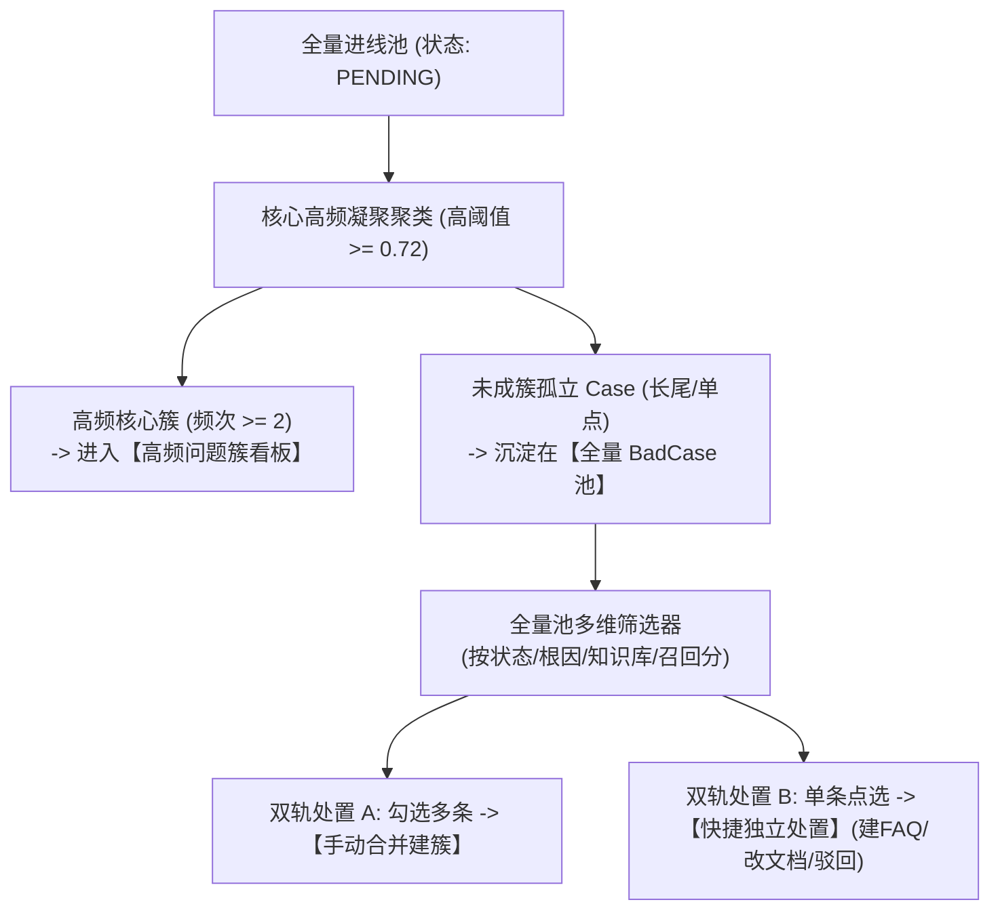
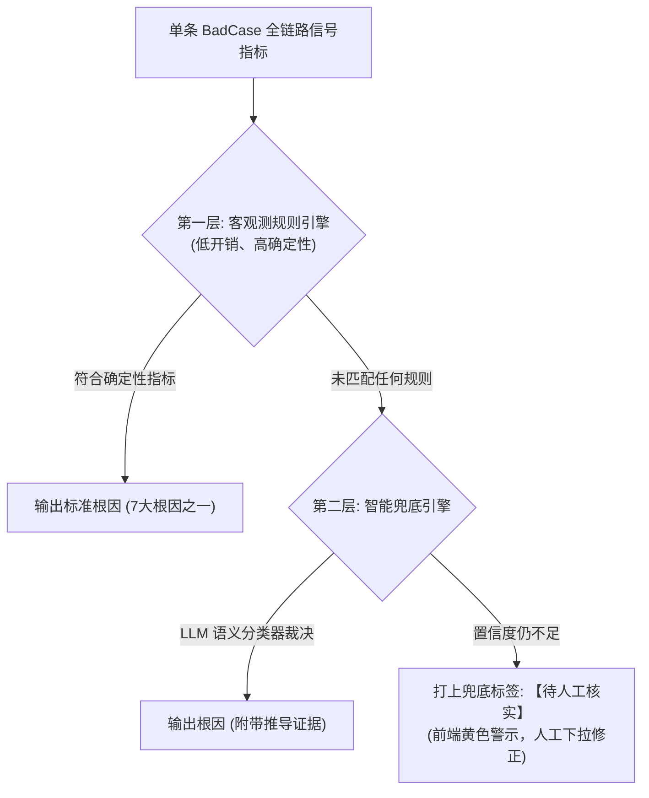
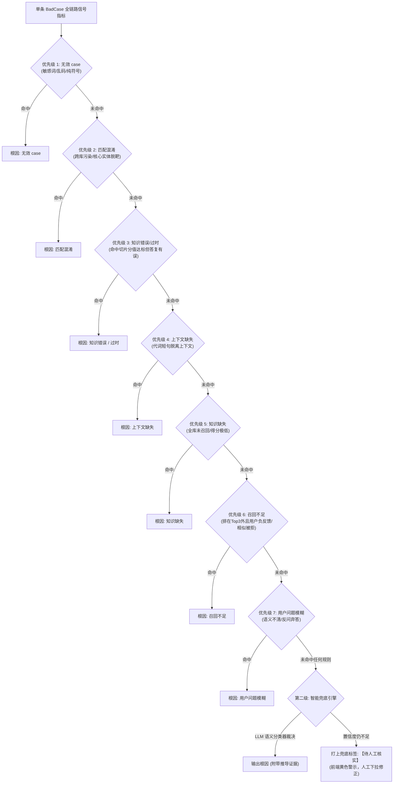

# BadCase 闭环治理模块优化与演进方案规范（V2.0）

## 一、方案背景与目标

在智能客服生产运营过程中，BadCase 治理是驱动知识库迭代与大模型 RAG 效果进化的核心飞轮。根据实际业务运行反馈，当前治理体系在“数据采集完整度”、“长尾聚类与防重机制”、以及“根因定位与治理建议透明度”上仍存在改进空间。

本规范整合并升级了近期的架构方案，明确四大核心改进目标：
1. **采集透明化**：展示 AI 命中知识切片，以“用户近三轮输入”为基准动态捕获完整对话上下文，并开通直接修订知识文档链路；
2. **聚类可控化**：摒弃算法黑盒的自适应聚类，采用“高频紧密聚类 + 全量池多维筛选”，支持长尾 Case 手动合并或单条直达处置，彻底根除重复聚类；
3. **根因标准化**：确立 7 大标准根因字典，依托全链路 5 维信号实现客观测规则优先判定，辅以大模型智能兜底；
4. **决策结构化**：通过加权汇聚算法得出簇整体根因，结构化输出决策依据与操作分类（场景 A~G）。

---

## 二、采集与上下文机制升级

### 2.1 命中知识文档与切片全链路透传
* **痛点**：原有 Case 仅记录问答文本，无法判断 AI 是依据哪篇文档、哪个章节答错，亦或是全库脱靶。
* **方案设计**：
  * **元数据落库**：在问答记录与 BadCase 创建时，透传最终送入 Prompt 的 Top-K 切片元数据：`doc_id`（文档ID）、`doc_name`（文档名称）、`heading_path`（级联层级路径）、`chunk_id`、`rerank_score`（重排置信分）。
  * **界面双模态渲染**：
    * **命中有效文档**：高亮展示【📚 命中知识来源】标签胶囊（如 `《电商通用退换货规范》> 3. 特殊品类细则`），支持点击气泡查看召回原文切片片段；
    * **未命中任何知识**：醒目标注【⚠️ 纯业务盲区：全库检索未命中】，直接指导运营无需翻查现有知识。

### 2.2 “用户近三轮输入”动态上下文回溯机制
* **痛点**：固定消息条数截断容易切碎多轮对话语义，或夹带过多无效系统提示。
* **边界算法设计**：
  * 从触发差评/质检标错的消息节点开始，**逆向沿时间轴向上回溯**；
  * 以 **角色为用户（User）的发言** 作为递增计数锚点：
    1. **累计达 3 轮**：当逆向捕获到第 3 个用户提问时截止，截取该提问至当前触发节点的**全部会话流**（含 3 次提问、中间穿插的每一次 AI 回答与系统提示）；
    2. **不足 3 轮**：若逆向追溯至会话首条消息时，用户提问累计未满 3 轮，则保留从开局至当前节点的全部内容。
  * **业务收益**：保证代词消解与上下文约束信息完备，同时杜绝上下文无上限膨胀。

### 2.3 知识文档修订（场景 C）闭环直达链路
* **交互设计**：在 BadCase 详情的命中知识标签旁、以及治理工作台工具栏中，增加【📝 修订原文档】快捷动作。
* **版本流流转**：
  1. 点击后调起知识编辑面板，自动载入该命中长文档的最新版本内容；
  2. 侧边栏自动附带当前 BadCase 的用户诉求与差评批注，方便运营针对性补齐例外细则或修正过期参数；
  3. 保存后自动创建该文档的草稿版本（`DocumentVersion`，状态流转为 `PENDING_REVIEW`），审核通过后自动回流闭环。

---

## 三、聚类引擎与全量池长尾治理体系



### 3.1 架构调整：放弃算法自适应，推行“核心高纯度簇 + 全量池兜底”
* **决策原因**：自适应算法放宽阈值容易引发语义漂移，将不相干的口语提问强行凑簇，形成脏数据。
* **执行策略**：
  * 聚类算法坚守严格的余弦相似度门槛（$\ge 0.72$），只聚合高频同质化问题；
  * 低频或独特的孤立 Case 不做强行降级归拢，保持单条形态保留在全量数据池中。

### 3.2 全量 BadCase 视图与多维筛选器
工作台开辟独立 Tab【全量 BadCase 清单】，提供多维筛选能力：
* **归属状态**：`全部` / `已成簇 (CLUSTERED)` / `未成簇长尾 (UNCLUSTERED)`；
* **根因标签**：按 7 大标准根因筛选；
* **命中状态**：`0 召回盲区` / `弱命中 (<0.60)` / `强命中差评 (>=0.60)`；
* **业务维度**：所属知识库、产品线、进线时间、处理状态（待处理、已处理、已驳回）。

### 3.3 未成簇 Case 的双轨处置机制
* **路径 A（手动合并建簇）**：运营在列表中勾选多条语义相近的长尾 Case，点击【手动合并建簇】，输入标准问题名称后生成新簇，进入批量治理流程；
* **路径 B（单条直接处置）**：对于偶发单点问题，直接在行内提供快捷操作：
  * 【直接新建 FAQ】 / 【追加至已有文档】 / 【修订原文档】 / 【标记为无效/驳回】。

### 3.4 聚类防重与状态机精准解耦
* **状态机流转设计**：
  * `COLLECTED`（新采集，未入簇）
  * `CLUSTERED`（已归入某个问题簇，锁定状态，后续增量聚类不再重复捞取）
  * `RESOLVED`（已采纳治理） / `REJECTED`（已驳回）
* **增量运行与全量重聚机制**：
  * **日常增量聚类**：仅扫描状态为 `COLLECTED` 的新增记录，先计算其与现有进行中老簇中心向量的相似度。达标则直接动态并入老簇（老簇计数 +1，样本扩充），不达标才尝试彼此聚类或保留在长尾池；
  * **重置全量重析**：运营主动触发“全量重新分析”时，弹窗二次警告，系统自动清空尚未采纳的历史待办簇，将未处理 Case 状态统一重置为 `COLLECTED` 后重新全局聚类，彻底根除“点击一次多一批重复簇”的隐患。

---

## 四、单条 BadCase 根因定位体系

### 4.1 标准根因分类字典

| 根因编码 | 根因名称 | 官方标准描述信息 |
| :--- | :--- | :--- |
| **RC_KNOWLEDGE_MISSING** | **知识缺失** | 知识库里面完全没有这个问题对应的答案，检索没有召回有效切片。 |
| **RC_RECALL_INSUFFICIENT** | **召回不足（有知识但没捞出来）** | 知识存在，但是相似度不够、chunk 切分问题、缺少相似问、排序低没进 top。 |
| **RC_KNOWLEDGE_ERROR** | **知识错误 / 过时** | 命中了知识，但知识本身内容不对、政策过期。 |
| **RC_MATCH_CONFUSION** | **匹配混淆（错召回别的知识）** | 召回了别的产品 / 别的知识，答非所问。 |
| **RC_CONTEXT_MISSING** | **上下文缺失** | 多轮对话，缺少上下文信息导致理解偏差。 |
| **RC_QUERY_AMBIGUOUS** | **用户问题模糊** | 用户提问语义不清、信息不全，不是知识库问题。 |
| **RC_INVALID_CASE** | **无效 case** | 闲聊、辱骂、乱码、敏感词、业务不支持解答。 |

---

### 4.2 全链路 5 大信号特征矩阵

在会话执行与 Case 采集时，自动化提取以下结构化指标：
1. **检索侧信号**：召回切片数量、Top-1 与 Top-3 得分（BM25、向量、Rerank）、切片所属库与文档、切片原文、是否命中跨库切片；
2. **用户反馈信号**：用户动作（差评 👎 / 否定推荐 / 直接转人工）、差评备注文本；
3. **AI 回答侧信号**：模型输出文本、是否触发无答案兜底模板、是否命中敏感词拦截；
4. **知识库元信号**：知识库启用状态、切片文档创建/修改时间、版本号、是否配置相似问；
5. **上下文信号**：本轮 query、逆向回溯近三轮输入间的全量交互流、是否存在代词与省略结构。

---

### 4.3 两级研判流：客观测规则优先 + 双重智能兜底



### 4.3 两级研判流：优先级短路规则库 + 智能兜底



#### 第一级：客观测规则库与判定优先级（短路判定机制）
为避免多规则冲突与重叠（如“既跨库污染又得分低”），客观规则**严格按照由强约束到弱约束的优先级顺序执行**。**核心原则：硬污染/无效内容先判 $\rightarrow$ 再判“命中了但是内容不对” $\rightarrow$ 再判“没拿到有效知识”。一旦命中高优先级规则，立即定性并短路返回，不再评估后续规则**。

1. **【优先级 1】无效 case（规则 6，优先硬拦截）**：
   * 触发条件：提问触发敏感词拦截，或字数小于配置阈值（`min_valid_len`，默认 $<2$），或被字符熵识别为乱码、连续无意义符号、纯表情。
2. **【优先级 2】匹配混淆（规则 2，跨库污染硬错误，优于知识缺失）**：
   * 触发条件：召回 Top-1 切片的归属产品线/知识库与当前会话不一致（跨库污染），或切片核心实体与提问显著不符（即使其匹配得分 $<0.30$，也优先定性为匹配混淆而非知识缺失）。
3. **【优先级 3】知识错误 / 过时（规则 4，命中合格但内容有误）**：
   * 触发条件：Top-1 检索分达到强命中阈值（$\ge \text{threshold\_high}$），AI 回复忠实反映了切片内容，但用户明确给出差评 👎，或坐席质检备注指出“政策已变/内容有误”，或文档更新时间早于新政策上线日。
4. **【优先级 4】上下文缺失（规则 5，多轮依赖）**：
   * 触发条件：单句提问包含代词（“它/这个/刚才那个”），字数低于短句阈值（`short_query_len`），脱离前序轮次无法独立表意，且单句检索得分极低。
5. **【优先级 5】知识缺失（规则 1，完全无答案）**：
   * 触发条件：召回切片数 $=0$ 或 Top-1 得分低于底线阈值（$< \text{threshold\_low}$），且 AI 回复触发兜底无答案话术。
6. **【优先级 6】召回不足（规则 3，漏洞修复：强绑定用户负反馈）**：
   * 触发条件（满足以下任一组合）：
     * **分支 A**：召回切片数 $>0$，分值处于相似推荐区间，AI 输出了相似推荐，但**用户明确点击了“否定/都不是”**；
     * **分支 B**：高相关切片排在候选区间（`candidate_rank_range`，默认 4~10 位）而未进入 Top-3，**并且最终用户没有采纳 Top-3 结果（强绑定负反馈：触发转人工、点差评 👎、或否定相似推荐）**。
     * *注：单纯“正确答案排在第 4 位”不等于 BadCase，必须搭配用户真实负反馈信号，防止将正常会话误判。*
7. **【优先级 7】用户问题模糊（规则 7，末位意图弱约束）**：
   * 触发条件：用户输入缺乏具体动作或实体，AI 触发了反问澄清话术，但用户直接弃答点踩退出。

#### 第二级：未匹配上的兜底方案（Fallback）
1. **轻量 LLM 结构化判决器**：将近三轮上下文、召回切片摘要、AI 回答打包，输入轻量判别模型，严格限定在 7 大根因字典中进行单选并输出依据；
2. **终极安全兜底（待人工核实）**：若 LLM 判定置信度依然不足，打上【待人工核实】标签，进入全量池待复核视图，支持运营在工作台下拉手动校正。

---

### 4.4 规则阈值配置化体系（按产品线/知识库独立配置）
* **痛点**：原有方案中 $0.30$、$0.70$、字数 $<5$、Rank 4~10 等数字硬编码在逻辑中。实际生产中，不同产品线（如复杂 SaaS 咨询 vs 快消电商售后）的最优召回与语义阈值存在显著差异。
* **配置化模型设计**：
  * 支持在管理后台按**【知识库】**和**【产品线】**维度独立覆盖与调优各项判定参数：
    * `threshold_low`（无答案最低门槛，默认 $0.30$）
    * `threshold_high`（强命中基准线，默认 $0.70$）
    * `short_query_len`（代词依赖短句字数上限，默认 $5$）
    * `candidate_rank_start` / `candidate_rank_end`（长尾候选切片监控位次，默认 $4 \sim 10$）
    * `context_window_rounds`（回溯用户输入轮数，默认 $3$）
  * **审计日志追踪**：所有阈值变更必须记录修改人、生效时间、变更前后对比值与所属知识库，确保调优过程完全可溯源、可回滚。

---

## 五、簇整体根因汇聚与 AI 治理操作映射

### 5.1 簇整体根因裁定算法
簇内汇聚了多条 Case 的单条根因，采用**“多数表决优先 + 严重度加权覆盖”**算法决裁簇整体根因：
1. **多数表决**：统计簇内单条根因分布，若某一根因占比 $\ge 60\%$，直接作为簇整体根因；
2. **严重度加权覆盖（平票或分散时）**：
   按知识库建设与业务影响严重度排序裁定：
   $$\text{知识缺失} > \text{知识错误/过时} > \text{召回不足} > \text{匹配混淆} > \text{上下文缺失} > \text{用户问题模糊} > \text{无效 case}$$

---

### 5.2 根因到 AI 治理操作分类映射矩阵

| 簇整体根因 (图二) | 对应官方描述信息 | AI 治理操作分类 | 系统推荐治理动作与闭环方案 |
| :--- | :--- | :--- | :--- |
| **知识缺失** | 知识库里面完全没有这个问题对应的答案，检索没有召回有效切片。 | **【场景 B：新建独立 FAQ】** | 自动提取代表问作为标准问，提取同义问法作为相似问，AI 生成解答草稿，提交超管审核。 |
| **召回不足**<br>*(有知识但没捞出来)* | 知识存在，但是相似度不够、chunk 切分问题、缺少相似问、排序低没进 top。 | **【场景 A：追加相似问法】** | 自动定位到目标低分文档，一键将本簇全部真实问法批量挂载为该文档的“相似问”，提升召回。 |
| **知识错误 / 过时** | 命中了知识，但知识本身内容不对、政策过期。 | **【场景 C：发起文档修订草稿】** | 定位目标长文档，拉起版本编辑流并提示修改对应条款，生成新版本草稿提交审核。 |
| **匹配混淆**<br>*(错召回别的知识)* | 召回了别的产品 / 别的知识，答非所问。 | **【场景 D：知识调优与负向排除】** | 提示配置“负向相似问/排除词”，或调整产品库路由隔离规则，纠偏召回范围。 |
| **上下文缺失** | 多轮对话，缺少上下文信息导致理解偏差。 | **【场景 E：优化多轮指代策略】** | 将样本沉淀至 Query 改写测试集，提示算法工程师优化前置改写 Prompt 或消解模型。 |
| **用户问题模糊** | 用户提问语义不清、信息不全，不是知识库问题。 | **【场景 F：配置反问澄清话术】** | 推荐在大类知识节点配置“引导追问卡片”或“意图澄清模板”，引导用户补充关键信息。 |
| **无效 case** | 闲聊、辱骂、乱码、敏感词、业务不支持解答。 | **【场景 G：整簇驳回 / 敏感词加黑】** | 一键整簇驳回移出治理池，支持将异常文本特征词批量加入风控黑名单或闲聊库。 |

---

### 5.3 工作台呈现规范示例

在工作台选定任意一个问题簇时，AI 诊断面板将完整结构化呈现：

```
┌────────────────────────────────────────────────────────────────────────┐
│ 📌 问题簇: 延迟发货赔付细则咨询 (累计进线 32 笔)                        │
├────────────────────────────────────────────────────────────────────────┤
│ 【簇整体根因】: 召回不足（有知识但没捞出来）                            │
│ 【根因标准定义】: 知识存在，但是相似度不够、chunk 切分问题、缺少相似问、  │
│                 排序低没进 top。                                       │
│ 【推荐操作分类】: 场景 A - 追加相似问法                                 │
├────────────────────────────────────────────────────────────────────────┤
│ 🔍 依据明细与信号支撑:                                                 │
│  • 簇内根因分布: 召回不足 (78%), 知识缺失 (22%) -> 多数表决达成裁定    │
│  • 核心命中诊断: 命中文档《发货与赔付规范》，但用户问法偏口语化，       │
│                 Rerank 分数仅 0.56 未进入前 3 位                       │
│  • 推荐治理动作: 建议将本簇 8 种变体问法批量追加为该知识的扩展相似问     │
├────────────────────────────────────────────────────────────────────────┤
│ [✨ 一键采纳追加相似问]  [📝 修订文档]  [🔗 关联已有知识]  [🚫 整簇驳回] │
└────────────────────────────────────────────────────────────────────────┘
```
