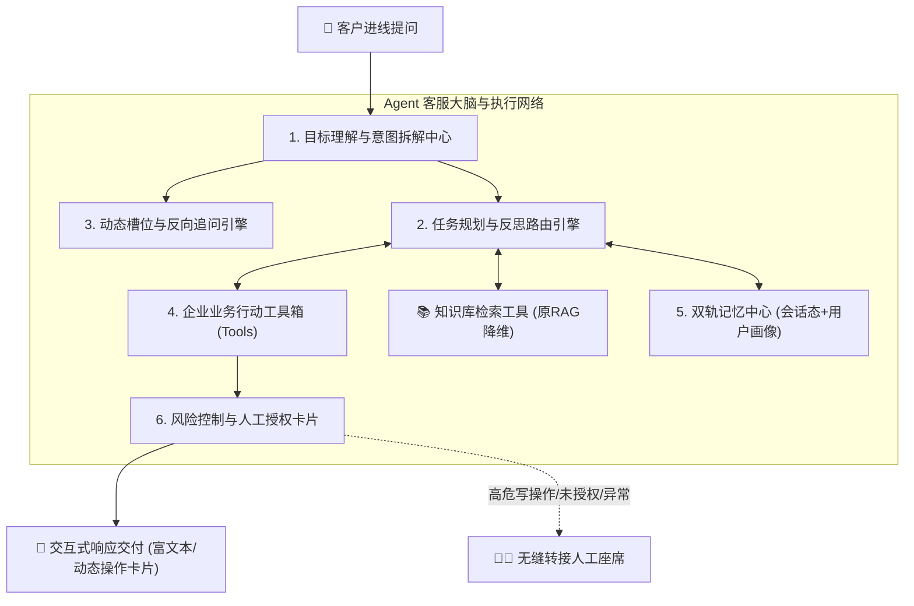

# 智能客服系统：从 RAG 客服到 Agent 客服升级方案与 BadCase 模块重构论证

---

## 第一部分：RAG 客服升级为 Agent 客服功能方案

### 1. 现状剖析与升级本质

| 维度 | 当前系统形态（RAG 知识检索客服） | 目标形态（Agent 智能体客服） |
| :--- | :--- | :--- |
| **工作模式** | **“单向查阅与问答”**：检索相关知识片段 $\rightarrow$ 组织语言 $\rightarrow$ 单次回答。 | **“感知-思考-行动-反馈”闭环**：理解目标 $\rightarrow$ 拆解步骤 $\rightarrow$ 调取工具/执行操作 $\rightarrow$ 校验结果 $\rightarrow$ 给出交付。 |
| **业务处理** | 静态单分支路由：在 `intent_classifier` 处硬编码分流，业务查询（`business_service`）仅支持只读展示订单/物流卡片。 | 动态任务执行：支持**多步复合任务、参数追问补全、真实业务办理（查/改/退/订/申诉）与回退重试**。 |
| **知识角色** | **系统核心本体**：一切问答都围绕知识库切片（Chunks）打分与召回展开。 | **降维为 Agent 的一种基础“工具（Skill）”**：知识库与订单接口、退款接口、风控接口并列协同。 |

---

### 2. Agent 客服系统功能蓝图

整个 Agent 客服体系在功能层面由 **6 大核心功能中心** 组成：

---

### 3. 各功能模块详细职责（都有什么、都做什么）

#### 模块一：目标理解与复合任务拆解中心
* **有什么功能**：
  * **复合意图拆解**：能识别一句话里的多个诉求（例如：“*上周买的服务器公网IP是多少？如果快过期了帮我顺便续费一个月，顺便开下发票*”）。
  * **主副意图分离**：区分“即时业务办理（续费、退款）”、“信息核对（查IP、查物流）”与“政策咨询（退款规则）”。
  * **口语化与代词指代消解**：结合上下文动态将“把这个退了”、“第二个发票重开一下”还原为具体的实体和业务单号。
* **具体做什么**：
  * 将复杂的非结构化提问拆解为一份**结构化的任务执行清单（Todo List）**，确定任务的先后依赖关系（如：先查订单状态 $\rightarrow$ 再判断是否符合退款条件 $\rightarrow$ 触发退款审核）。

#### 模块二：动态槽位抽取与主动反向追问引擎
* **有什么功能**：
  * **业务要素（槽位）完整度校验**：定义每个业务所需的必填参数（如退款需要：订单号、退款原因、退款金额；修改地址需要：订单号、新收件人、联系电话、新地址）。
  * **主动引导反问（Ask for Clarification）**：缺失必填信息时，不再像 RAG 那样直接兜底或甩出整篇通用文章，而是主动精准发问。
  * **渐进式填槽**：在多轮对话中逐步收集用户零散透露的参数，直到满足执行条件。
* **具体做什么**：
  * 当用户说“帮我改一下收件地址”时，系统检测到缺少【订单号】和【新收件信息】，主动弹出：“*请问您需要修改哪笔订单的地址？这是您近期的两笔订单（展示卡片单选），修改后的新收件地址是什么？*”

#### 模块三：企业业务行动工具箱（Tools / Action Center）
* **有什么功能**：
  * **只读查询类工具**：订单查询、实时物流轨迹追踪、电子发票下载、账户余额/算力配额查询。
  * **业务写操作类工具**：发起退款申请、修改收货地址、取消未支付订单、提交工单、延长收货时间、代客预订/续费。
  * **自动化环境感知工具**：查询当前商品库存、查询当前促销规则、系统健康度自检。
* **具体做什么**：
  * Agent 大脑根据拆解后的任务，自主决定调用哪一个或哪一组业务接口；
  * 解析接口返回的原始业务数据，将其**人性化、结构化**地组装成用户易读的回复或交互卡片。

#### 模块四：知识协同工具（RAG 降维接入）
* **有什么功能**：
  * 将现有的 **BM25 + 向量混合检索 + Rerank 重排系统** 封装为一个独立的“**企业政策与规章查阅工具（Knowledge Retriever）**”。
  * **事实交叉校验**：当知识库内容与实时接口数据产生分歧时进行仲裁（例如：知识库规定“虚拟商品不支持退款”，但后台接口返回“管理员已特批绿色退款通道”，优先以业务实时状态为准）。
* **具体做什么**：
  * 当任务涉及业务规则答疑时，Agent 自动调用知识工具查阅相关法条或政策；
  * 如果是纯闲聊或纯业务办理（如查物流），Agent **根本不需要调用知识检索工具**，避免无谓的切片检索开销和噪声干扰。

#### 模块五：双轨记忆中心（Memory Hub）
* **有什么功能**：
  * **短期任务记忆（Working Memory）**：记录当前多步任务进行到了哪一步（当前已执行了查单，等待用户确认退款金额，下一步将调用退款接口）。
  * **长期用户画像记忆（Profile & History Memory）**：记录客户的核心偏好、企业角色（是企业超管还是普通运维）、历史常选地址、客诉情绪倾向。
* **具体做什么**：
  * 保证用户在跨多轮闲聊或被其他事情打断后，重新回来时系统依然记得：“*刚才为您查询到订单 ORD-20261025-8891，您刚才想要申请退款，我们继续办理吗？*”

#### 模块六：安全风控、二次确认与人机无缝协作（Human-in-the-Loop）
* **有什么功能**：
  * **高危写操作阻断与确认卡片**：凡涉及“付款、退款、销户、转账、重置密码”等资金或敏感数据变更，禁止 Agent 盲目单边静默执行，必须生成**带明确参数的交互式确认卡片**（展示退款明细，必须用户主动点击【确认办理】才触发真实接口）。
  * **自主降级与智能转人工**：
    * 当工具执行连续报错（如外部系统 500、余额不足）；
    * 识别到用户情绪出现严重愤怒、辱骂；
    * 业务超出 Agent 自主决策权限（如用户要求特批额外补偿优惠券）。
* **具体做什么**：
  * 自动打包**当前任务的执行链上下文、已收集的槽位参数、当前报错根因**，无缝移交给人工客服，坐席打开工作台即可一键接盘，无需用户重新从头复述。

---

## 第二部分：现有 BadCase 模块在 Agent 模式下是否需要重构？

### 1. 明确结论

> **明确结论：现在的 BadCase 模块必须进行“升维重构”，但绝非推翻重建，而是“核心基建继承 + 业务维度升维”。**

* **无需推翻的基建（平滑复用）**：
  * 三大采集入口（用户显式点赞/点踩、系统阈值/异常拦截、坐席人工标注标错）；
  * 闭环处理主骨架（采集 $\rightarrow$ 清洗去重 $\rightarrow$ 语义聚类成簇 $\rightarrow$ 工作台处置 $\rightarrow$ 审核发布 $\rightarrow$ 回归验证）；
  * 现有的长文本文档与 FAQ 采纳修订链路（新建 FAQ、追加相似问、修改原文档）。
* **必须重构的核心原因**：
  * 现有 BadCase 的数据模型、7 大根因字典、分析算法与治理动作，**100% 绑定在“RAG 知识检索”的局部世界里**（知识有没有搜出来、切片切得好不好、知识有没有过期）。
  * 在 Agent 模式下，AI 的失败已远远超出“知识搜不准”，更多出现在**“工具调错了”、“参数填歪了”、“任务规划走入死循环”、“没有向用户追问确认就擅自操作”**。如果 BadCase 不升级，这些严重的业务执行事故在系统里将处于“完全无法定性、无法聚类、无法自动化治理”的裸奔状态。

---

### 2. 传统 RAG 与 Agent 模式下 BadCase 核心对比

| 评估维度 | 当前 RAG BadCase 现状 | Agent 模式下的 BadCase（重构后） |
| :--- | :--- | :--- |
| **问题本质** | **“认知/答疑失败”**：没读懂、搜不出、答错了。 | **“行动/执行失败”**：规划错、调错工具、填错参数、越权操作。 |
| **数据采集深度** | 仅记录：提问、回答、召回的知识切片（`recall_sources`）。 | 必须记录：**完整思维轨迹（Thought/Action/Observation）**、工具入参及返回值、当前槽位状态。 |
| **根因归因** | 局限在 7 类知识检索根因（知识缺失、召回不足、知识错误等）。 | 升维为包含**意图理解、工具调用、知识事实、安全合规**的全链路矩阵。 |
| **治理手段** | 只能做知识库维护（新建 FAQ、补相似问、改文档）。 | 扩展出 **Prompt 调优、工具参数规范修复、Few-shot 示例注入、安全拦截策略调整**。 |
| **回流验证** | 仅重测：新 Query 能否再次召回该切片（召回率测试）。 | 重跑：**全链路智能体轨迹回放，验证任务是否能成功闭环办理（任务成功率）**。 |

---

### 3. BadCase 模块具体需要重构哪些功能？

针对你的项目，建议对 BadCase 进行以下 **4 大维度的结构化功能重构**：

```mermaid
flowchart LR
    subgraph S1["1. 采集数据结构重构"]
        M1["扩展录入：Agent 思考过程 (Thought)"]
        M2["扩展录入：工具调用链 (Tool & Params)"]
        M3["扩展录入：业务接口响应与中间状态"]
    end

    subgraph S2["2. 根因分类体系升维"]
        R1["原知识类根因 (缺失/过时/未召回)"]
        R2["新增: 规划与拆解根因 (死循环/复合意图丢失)"]
        R3["新增: 工具调用根因 (工具选错/参数抽取错误)"]
        R4["新增: 交互与安全根因 (机械反问/未确认越权)"]
    end

    subgraph S3["3. 治理动作库重构"]
        A1["原知识动作 (建FAQ/改文档/加相似问)"]
        A2["新增: 工具描述 (Tool Prompt) 优化草稿"]
        A3["新增: 注入标准纠错 Few-Shot 样本"]
        A4["新增: 动态槽位必填规则调整"]
    end

    subgraph S4["4. 效果回流验证重构"]
        V1["从单一『切片命中率测试』"]
        V2["升级为『Agent 模拟环境任务闭环回放测试』"]
    end

    S1 --> S2 --> S3 --> S4
```

#### 功能重构一：采集快照从“切片证据”升级为“Agent 行动全轨迹（Trace）”
* **旧功能局限**：数据库仅保存 `recall_sources`（召回的切片ID和得分）。Agent 模式下一旦退款失败，运营在后台根本看不到 Agent 是在第几步调用的退款接口，传了什么金额。
* **重构后功能**：
  * **全轨迹黑匣子记录**：除了保留用户提问和最终回复，额外采集 Agent 在后台的**每一步思考步骤（Step）、工具名称、传递参数快照（Input JSON）、接口返回状态码及原始报文（Observation）**；
  * **治理工作台时间轴展示**：运营人员在查看 Case 时，不仅能看到对话气泡，还能展开一条类似“快递轨迹”的 Agent 执行时间线（*第1步：识别为退款意图 $\rightarrow$ 第2步：调用订单查询成功 $\rightarrow$ 第3步：调用退款接口因缺少手机号验证码报错*），责任一目了然。

#### 功能重构二：根因字典（Root Cause）由 7 类知识根因升级为三维矩阵
将原有平铺的 7 类根因升级为覆盖智能体全流程的三大维度：

* **维度 A：规划与意图根因（Planning & Intent）**
  * `复合任务漏解`：用户提了三个需求，Agent 只完成了第一个就结束了；
  * `规划死循环（Looping）`：Agent 在两个工具之间反复相互调用无法收敛；
  * `过度反问/提问死锁`：用户已提供信息，Agent 依然机械地向用户重复索要。
* **维度 B：行动与工具根因（Tool & Action）**
  * `工具选择错误`：本该调用“查询物流”，却调用了“提交投诉工单”；
  * `参数抽取错误（Slot Error）`：把用户的收件人姓名填成了订单商品名；
  * `接口容错失败`：外部 ERP 超时返回 500，Agent 没有优雅降级，而是直接将报错代码吐给用户。
* **维度 C：安全与知识根因（Safety & Knowledge，继承原系统）**
  * `知识缺失 / 召回不足 / 知识过时`（保留原有 7 大根因中合理的知识部分）；
  * `越权与安全违规`：未经过用户点击【确认退款】卡片，私自完成了退款扣减。

#### 功能重构三：治理工作台处置动作库（Recommended Action）重构
* **旧功能局限**：原系统的建议动作只有 `CREATE_FAQ`（新建FAQ）、`ADD_SIMILAR_QUERY`（加相似问）、`UPDATE_DOC`（改文档）。运营遇到工具调错时无法处置。
* **重构后功能**：
  * **场景 1（保留）：如果是知识缺失或政策答错** $\rightarrow$ 一键触发原有的新建 FAQ、补充相似问或修订长文本；
  * **场景 2（新增）：如果是工具选错或参数填错** $\rightarrow$ 提供【**一键沉淀为 Agent 引导样本（Few-Shot）**】动作：运营在界面上纠正正确调用的工具和参数，一键存入 Agent 的技能指导案例库；
  * **场景 3（新增）：如果是工具理解偏差** $\rightarrow$ 提供【**优化工具提示词说明（Tool Doc Patch）**】草稿：直接修改该业务接口的自然语言功能描述（比如补充：“*注意：查询历史订单时必须传 customer_id，不得为空*”）；
  * **场景 4（新增）：如果是规则冲突** $\rightarrow$ 一键发起【**业务规则仲裁草稿**】。

#### 功能重构四：效果回流验证（Validation）从“文本匹配”升级为“智能体沙箱回放”
* **旧功能局限**：原系统是将聚类簇里的历史 Query 重新送入检索器，看命中分数是否超过阈值（`pass_rate`）。
* **重构后功能**：
  * **沙箱 Mock 回放验证**：在测试沙箱中，将导致 BadCase 的用户原始会话流（含多轮上下文）重新注入 Agent；
  * **双重达标判定**：
    1. **行动正确性**：Agent 是否在正确的时间选择了正确的工具，参数是否完整；
    2. **交互完备性**：最终交付的内容是否解决了痛点，是否规避了上一版的报错。

---

## 总结方案建议

1. **客服体系演进**：不是推翻现有的 RAG，而是把原本作为“系统骨架”的 RAG 降维收敛为 Agent 工具箱中的一项**“知识查阅子技能”**；系统顶层引入**任务拆解、槽位追问、业务操作工具箱与安全确认卡片**，让客服从“只动嘴解释”跨越到“能真正代客办理业务”。
2. **BadCase 模块演进**：**必须重构**。保留其优秀的采集与聚类闭环架构，但必须将数据字段、根因判定、治理建议与回归验证从原本狭隘的“知识检索层”全面**升维覆盖到“Agent 思考与工具执行层”**，才能为下一阶段的 Agent 客服提供真正可落地的质检与自进化飞轮。
