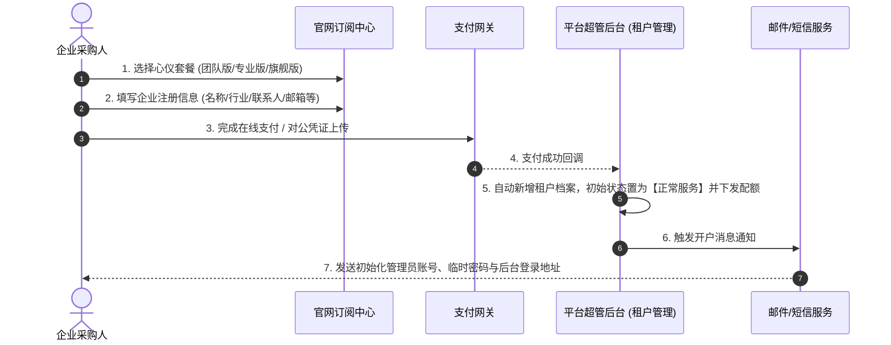

# 智能客服 SaaS 平台产品与商业化规划方案

## 三、 SaaS 商业化订阅与企业入驻

### 1. 阶梯套餐与配额划分
定价模型按企业组织规模与业务复杂度进行梯度划分，纯按软件授权与资产额度计费：

| 权益维度 | 体验版 / 团队版 | 专业版 | 旗舰版 | 企业尊享版（定制） |
| :--- | :--- | :--- | :--- | :--- |
| **适用客群** | 初创团队、单一业务试水 | 中型企业、多业务线运营 | 大型成熟企业、多客服团队 | 集团型企业、复杂定制需求 |
| **产品线配额** | **1 条** 产品线 | **3 条** 产品线 | **10 条** 产品线 | 不限（按需定制） |
| **知识库配额** | **2 个** 知识库 | **8 个** 知识库 | **30 个** 知识库 | 弹性扩展 |
| **人工客服坐席** | **3 个** 标准坐席 | **10 个** 标准坐席 | **30 个** 标准坐席 | 弹性按需扩展 |
| **知识主管坐席** | **1 个** 运营坐席 | **2 个** 运营坐席 | **5 个** 运营坐席 | 按需配置 |
| **模型接入支持** | 企业自配生成/向量模型 | 企业自配生成/向量模型 | 企业自配生成/向量模型 | 支持内网专有模型接入 |
| **单库文档上限** | 1,000 篇 / 库 | 10,000 篇 / 库 | 50,000 篇 / 库 | 专属独立配额 |

### 2. 企业购买与自动入驻流程

* **企业信息填报字段**：
  * **企业基础信息**：企业全称、统一社会信用代码（选填）、官方网站。
  * **联系人信息**：管理员姓名、联系手机（接收开户账号与临时密码）、工作邮箱。
  * **业务属性**：所属行业（电商、医疗、SaaS、教育、智能硬件、传统制造等）、主营业务线说明。
* **数据落库与通知**：
  * 支付成功后，系统即刻在平台超管端的**“租户管理”**模块生成一条独立租户实例。
  * 自动下发对应版本的初始配额（产品线数、知识库数、坐席数），并向企业联系人手机和邮箱下发初始管理员账号与后台链接。

---

## 四、 企业客户管理员核心模块规划

企业管理员拥有该租户的全局最高权限，日常遵循**“基础配置到位、团队分工授权、轻日常干预”**的原则。

### 1. 模型配置模块（核心：自主配置双模型）
平台不承担企业大模型的推理开销，企业管理员在此模块配置企业自有的模型能力，保障数据隐私与成本自主可控：

#### (1) 文本生成模型（LLM）配置
* **功能作用**：驱动前台机器人多轮对话理解、智能问答生成、人工客服辅助草稿推荐及会话摘要。
* **支持服务商**：OpenAI、DeepSeek、阿里通义千问、智谱清言、百度文心、Moonshot、自定义兼容 OpenAI 规范的 API 接口（适用于企业本地部署的 vLLM / Ollama）。
* **配置字段**：
  * 模型名称（如 `deepseek-chat`, `qwen-plus`, `gpt-4o`）
  * API Base URL（默认或私有服务地址）
  * API Key（支持隐藏脱敏与安全加解密存储）
  * 参数微调：温度值（Temperature 0~1）、最大输出长度（Max Tokens）
* **连通性校验**：界面提供一键“连通性测试”交互，发送测试 Prompt，验证是否能正常返回应答。

#### (2) 向量化模型（Embedding）配置
* **功能作用**：驱动企业知识库文档切片向量化、用户提问语义检索及相似度评分计算。
* **支持服务商**：OpenAI (text-embedding-3-small/large)、智谱 (Embedding-3)、阿里通用文本向量、本地 BGE 兼容接口。
* **配置字段**：
  * 向量模型名称（如 `text-embedding-3-small` / `bge-large-zh`）
  * API Base URL 与 API Key
  * 向量维度（Dimensions）与检索匹配阈值（Score Threshold）
* **嵌入效果自检**：提供测试输入框，输入测试文本即可实时校验向量模型返回状态与耗时。

### 2. 产品线与多知识库管理（1:N 层级体系）
企业业务通常具备多条业务支线，系统建立直观的树状层级：
* **产品线（Product Line）**：划分企业业务线（如“智能硬件线”、“SaaS 软件线”、“增值服务线”）。
* **挂载知识库（Knowledge Base）**：
  * 每条产品线下可灵活挂载多个专属知识库。例如在“智能硬件线”下挂载：《新手使用指南》、《常见硬件故障排除库》、《售后保修政策库》。
  * 支持配置知识库的使用场景（前台机器人直接调用 / 仅供内部人工客服坐席参考）。

### 3. 人员与分组管理（客服与知识运营）
* **业务分组绑定**：以产品线或服务场景建立业务分组（如“数码售后客服组”、“技术支持知识运营组”）。
* **人工客服管理**：
  * 新增/编辑/删除客服账号，设定最大同时接待会话上限。
  * 将客服指派至具体的产品业务分组；支持按分组筛选客服列表、查看客服基本信息状态及分配情况。
* **知识运营/主管管理**：
  * 新增/编辑/删除知识运营人员账号。
  * 将知识运营指派绑定到具体产品分组

---

## 五、 平台超级管理员端（租户治理与商业化运营）

### 1. 租户状态全生命周期管理
* **正常运行（Active）**：租户正常使用所有功能。
* **业务冻结（Frozen）**：租户到期未续费或触碰合规风险时触发。系统自动锁定前台客服功能与文档处理能力，仅保留后台只读权限，数据保留 30-90 天缓冲期。
* **租户启停（Disabled）**：管理员可手动快速暂停某租户服务以应对突发安全事件。
* **租户注销（Terminated）**：客户主动解约或超期未续费，彻底回收云端存储资源，并支持合规数据清退擦除。

### 2. 商业账务与履约监控
* **租户台账卡片**：直观展示租户套餐名称、有效起止时间、累计付费金额、最后登录时间、当前履约状态。
* **订单与支付流水**：追溯线上扫码支付、线下对公转账流水及发票开具状态。
* **到期预警机制**：超管后台高亮提醒 30 天/7 天内即将到期的租户，便于销售或客户成功团队主动跟进续费。

### 3. 弹性配额动态调整（支持非标商业诉求）
在标准套餐之外，超管可针对具体租户进行**“非标配额追加”**：
* 独立调整**产品线数量上限**与**知识库数量上限**。
* 单独追加**客服坐席配额**或**知识主管坐席配额**（无需强制客户升级更高阶套餐）。

