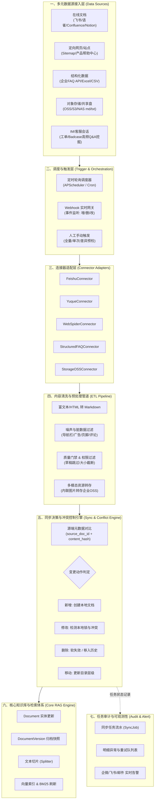
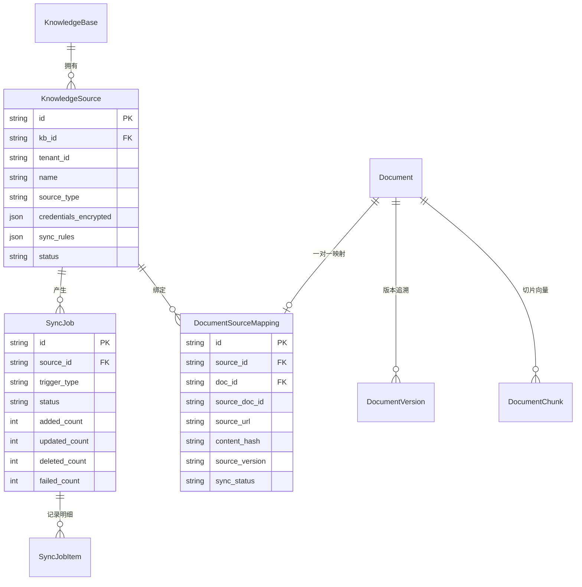
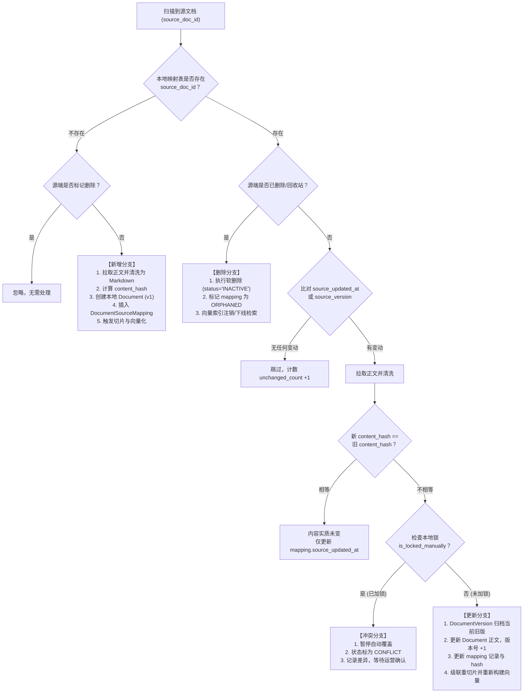
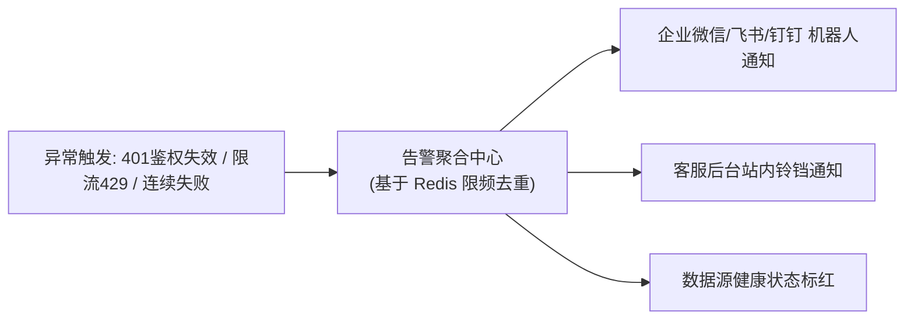
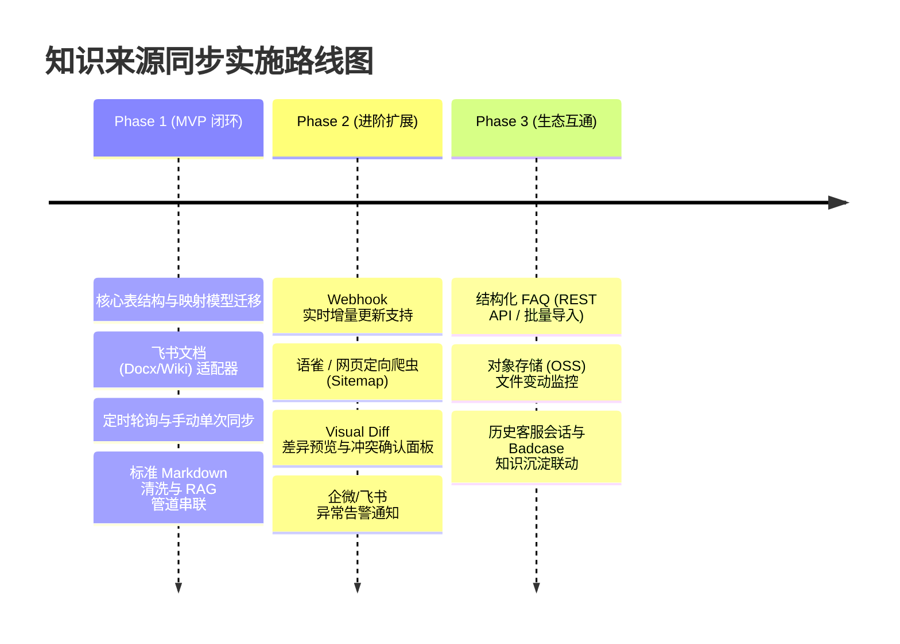

# 智能客服知识库 - 知识来源同步（Knowledge Source Sync）系统设计方案

---

## 1. 系统定位与设计原则

知识来源同步模块（Knowledge Source Synchronization Engine）是企业级智能客服知识库的**“进水管”**与**“数据上游治理网关”**。

它旨在解决传统知识库依赖手工搬运、时效性滞后、多源格式不一、上游变更易引发本地数据混乱等痛点。本方案在设计上严格遵循以下四项核心原则：

1. **唯一主键映射（Source ID Binding）**：严格以源端全局唯一实体 ID（如飞书 `doc_token` / 语雀 `slug` / 网页规范化 URL）为映射主键，杜绝按文档名匹配造成的重名混乱与移动目录误判。
2. **重构免疫与单向流转（Clean Data Flow）**：数据流严格遵循 `源端抽取 -> 规范化清洗 (ETL) -> 冲突决议 -> 版本归档 -> 切片分块 -> 向量化检索`，各层解耦，适配器即插即用。
3. **版本可溯与安全回滚（Zero-Loss Versioning）**：深度复用系统现有的 `Document`、`DocumentVersion`、`DocumentChunk` 架构；源端修改自动生成新版本，删除默认执行软失效，保障历史服务质量可追溯。
4. **租户与产品双重隔离（Multi-Tenant Isolation）**：同步任务与外源凭证严格归属到具体租户和 `KnowledgeBase.product_code`，杜绝跨企业越权访问与知识污染。

---

## 2. 总体系统架构设计



---

## 3. 核心数据模型设计 (Data Models)

系统设计 3 张核心新表，并对现有的 `documents` 表进行轻量字段扩充。

### 3.1 实体关系图 (ER Diagram)



### 3.2 数据结构定义 (SQL / SQLAlchemy 规范)

#### 1. 数据源配置表 (`knowledge_sources`)
用于统一管理各外部源的认证信息、同步周期、过滤规则与绑定关系。

```sql
CREATE TABLE knowledge_sources (
    id VARCHAR(36) PRIMARY KEY,
    kb_id VARCHAR(36) NOT NULL REFERENCES knowledge_bases(id) ON DELETE CASCADE,
    tenant_id VARCHAR(64) NOT NULL DEFAULT 'default',
    name VARCHAR(128) NOT NULL,
    source_type VARCHAR(32) NOT NULL, -- FEISHU, YUQUE, CONFLUENCE, WEB_CRAWLER, FAQ_API, OSS_STORAGE
    status VARCHAR(16) NOT NULL DEFAULT 'ACTIVE', -- ACTIVE, INACTIVE, ERROR
    
    -- 凭据信息（AES-256 加密保存：app_id, app_secret, access_token, api_key, cookie等）
    credentials_encrypted TEXT NOT NULL,
    
    -- 调度策略
    sync_mode VARCHAR(16) NOT NULL DEFAULT 'POLL_INCREMENTAL', -- FULL, POLL_INCREMENTAL, WEBHOOK
    cron_expression VARCHAR(64) DEFAULT '0 */2 * * *', -- 默认每两小时轮询一次
    
    -- 过滤与清洗规则配置
    sync_rules JSONB NOT NULL DEFAULT '{
        "folder_tokens": [],          -- 指定同步的目录/节点ID白名单
        "exclude_draft": true,        -- 是否过滤草稿状态文档
        "exclude_archived": true,     -- 是否跳过已归档文档
        "max_file_size_mb": 10,       -- 单文档大小上限
        "auto_publish": true,         -- 是否自动通过并向量化上线
        "conflict_strategy": "SOURCE_OVERWRITE" -- SOURCE_OVERWRITE, MANUAL_DIFF_CONFIRM
    }',
    
    last_sync_at TIMESTAMPTZ,
    last_sync_status VARCHAR(16),
    created_by VARCHAR(64) NOT NULL,
    updated_by VARCHAR(64) NOT NULL,
    created_at TIMESTAMPTZ NOT NULL DEFAULT NOW(),
    updated_at TIMESTAMPTZ NOT NULL DEFAULT NOW()
);
CREATE INDEX idx_kb_sources_kbid ON knowledge_sources(kb_id);
CREATE INDEX idx_kb_sources_tenant ON knowledge_sources(tenant_id);
```

#### 2. 源文档与本地文档映射表 (`document_source_mappings`)
核心防重与增量判定表，维系外部唯一 ID 与本地 `Document.id` 的对应关系。

```sql
CREATE TABLE document_source_mappings (
    id VARCHAR(36) PRIMARY KEY,
    source_id VARCHAR(36) NOT NULL REFERENCES knowledge_sources(id) ON DELETE CASCADE,
    doc_id VARCHAR(36) NOT NULL REFERENCES documents(id) ON DELETE CASCADE,
    
    -- 外部系统的唯一全局标识（如飞书 doc_token, 语雀 doc_id, 网页规范化 URL）
    source_doc_id VARCHAR(255) NOT NULL,
    source_url TEXT,
    source_title VARCHAR(255),
    source_folder_path VARCHAR(512), -- 外部文档所在的路径层级（如 /产品手册/支付体系/退款流程）
    
    -- 变更比对关键属性
    content_hash VARCHAR(64) NOT NULL, -- 正文清洗后的 SHA256 / MD5 哈希值
    source_updated_at TIMESTAMPTZ,     -- 源端报告的最后修改时间
    source_version VARCHAR(64),        -- 源端版本号/ETag
    
    -- 状态与同步管控
    sync_status VARCHAR(16) NOT NULL DEFAULT 'SYNCED', -- SYNCED, CONFLICT, FAILED, ORPHANED
    is_locked_manually BOOLEAN NOT NULL DEFAULT FALSE, -- 若运营在本地手工编辑过，可加锁保护
    
    created_at TIMESTAMPTZ NOT NULL DEFAULT NOW(),
    updated_at TIMESTAMPTZ NOT NULL DEFAULT NOW(),
    
    CONSTRAINT uq_source_doc UNIQUE (source_id, source_doc_id)
);
CREATE INDEX idx_doc_mapping_source ON document_source_mappings(source_id);
CREATE INDEX idx_doc_mapping_docid ON document_source_mappings(doc_id);
```

#### 3. 同步批次任务表 (`sync_jobs`) 与明细表 (`sync_job_items`)
```sql
CREATE TABLE sync_jobs (
    id VARCHAR(36) PRIMARY KEY,
    source_id VARCHAR(36) NOT NULL REFERENCES knowledge_sources(id) ON DELETE CASCADE,
    trigger_type VARCHAR(16) NOT NULL, -- MANUAL, SCHEDULED, WEBHOOK
    status VARCHAR(16) NOT NULL,       -- PENDING, RUNNING, COMPLETED, FAILED, PARTIAL_SUCCESS
    
    started_at TIMESTAMPTZ NOT NULL DEFAULT NOW(),
    finished_at TIMESTAMPTZ,
    
    total_scanned INT NOT NULL DEFAULT 0,
    added_count INT NOT NULL DEFAULT 0,
    updated_count INT NOT NULL DEFAULT 0,
    deleted_count INT NOT NULL DEFAULT 0,
    unchanged_count INT NOT NULL DEFAULT 0,
    failed_count INT NOT NULL DEFAULT 0,
    
    error_summary TEXT
);

CREATE TABLE sync_job_items (
    id VARCHAR(36) PRIMARY KEY,
    job_id VARCHAR(36) NOT NULL REFERENCES sync_jobs(id) ON DELETE CASCADE,
    source_doc_id VARCHAR(255) NOT NULL,
    doc_title VARCHAR(255),
    action VARCHAR(16) NOT NULL,       -- CREATE, UPDATE, SOFT_DELETE, SKIP, ERROR
    status VARCHAR(16) NOT NULL,       -- SUCCESS, FAILED, CONFLICT_PENDING
    diff_summary JSONB,                -- 变更统计（行数增删、标题修改等）
    error_message TEXT,
    created_at TIMESTAMPTZ NOT NULL DEFAULT NOW()
);
```

#### 4. 现有 `documents` 表的平滑扩展
在现有的 `documents` 表上增补外挂追溯字段，无需破坏原有结构：
- `source_origin`: `MANUAL_UPLOAD` / `SYNC_ENGINE`（标识文档是由管理员本地上传还是外部同步而入）
- `source_id`: 可空外键，指向所属的 `knowledge_sources.id`
- `is_external_controlled`: 布尔值，标识是否完全受外部源托管

---

## 4. 连接器统一接口规范 (Connector Adapter Architecture)

采用标准的面向对象策略/适配器模式，通过基类 `BaseKnowledgeConnector` 规范所有来源的行为，确保新增数据源时不侵入核心调度代码。

### 4.1 抽象连接器接口定义

```python
from abc import ABC, abstractmethod
from typing import List, Dict, Any, Optional
from dataclasses import dataclass
from datetime import datetime

@dataclass
class SourceDocumentMetadata:
    """源端元数据概要"""
    source_doc_id: str
    title: str
    folder_path: str
    source_url: str
    source_updated_at: datetime
    source_version: Optional[str]
    is_draft: bool = False
    is_deleted: bool = False

@dataclass
class RawSourceDocument:
    """源端拉取出的原始正文载荷"""
    metadata: SourceDocumentMetadata
    raw_content: str
    content_format: str  # HTML, DOCX_BLOCKS, MARKDOWN, JSON_FAQ
    extra_attributes: Dict[str, Any]

class BaseKnowledgeConnector(ABC):
    """知识源通用抽象连接器接口"""

    def __init__(self, credentials: Dict[str, Any], sync_rules: Dict[str, Any]):
        self.credentials = credentials
        self.sync_rules = sync_rules

    @abstractmethod
    async def test_connection(self) -> Dict[str, Any]:
        """连通性与权限探测：返回成功标识或详细失败原因"""
        pass

    @abstractmethod
    async def list_documents(self, last_sync_time: Optional[datetime] = None) -> List[SourceDocumentMetadata]:
        """增量/全量扫描源端文档目录，返回元数据列表"""
        pass

    @abstractmethod
    async def fetch_document_content(self, source_doc_id: str) -> RawSourceDocument:
        """根据源文档 ID 获取文档正文及完整资源"""
        pass

    @abstractmethod
    async def parse_webhook_event(self, headers: Dict[str, str], payload: Dict[str, Any]) -> Optional[Dict[str, Any]]:
        """解析 Webhook 回调事件，提取变动的 source_doc_id 与事件类型 (ADD/UPDATE/DELETE)"""
        pass
```

### 4.2 主流数据源落地技术要点

| 数据源类型 | 官方 API / 核心抓取协议 | 增量变更感知机制 | 内容清洗重点与坑点 |
| :--- | :--- | :--- | :--- |
| **飞书文档 (Feishu)** | 开放平台 Docx API / Wiki API (`tenant_access_token`) | 1. 订阅文档变更事件 Webhook<br>2. 轮询调用知识库节点列表接口，比对 `edit_time` | 嵌套 Callout 块、画板白板不可导出的情况需优雅降级为占位符；富文本内嵌图片需带签名 Token 下载后转存至内部对象存储。 |
| **语雀 (Yuque)** | 语雀 v2 REST API (Personal / App Token) | 1. Webhook (`doc.update`, `doc.delete`)<br>2. Repo Docs API 比对 `updated_at` | 语雀自研 Lake 格式需调用官方导出 Markdown 接口，或解析其 AST 转 Markdown；过滤未发布的草稿状态。 |
| **Confluence** | Atlassian REST API (`/wiki/rest/api/content`) | 1. CQL 语句过滤 `lastModified >= 'xxx'`<br>2. Confluence Webhook 事件 | 复杂 HTML 需过滤 Confluence 宏标记（如 TOC 宏、Jira 关联卡片）；保留表格与代码块的高保真结构。 |
| **定向网页爬虫** | 定向 `trafilatura` + Sitemap XML + Playwright | 1. 读取 Sitemap `<lastmod>` 属性<br>2. 发起 HTTP HEAD 请求对比 `ETag` / `Last-Modified` | 必须严格限定域名白名单；采用 DOM 密度分析去除页眉、页脚、侧边导航栏及 Cookie 弹窗；过滤纯锚点死循环。 |
| **结构化 FAQ** | 1. 客户 OpenAPI 推送 / 定时拉取<br>2. Excel / CSV 批量模板导入 | 比对问答对内容散列 (`hash(standard_q + answers)`) | 支持标准问、多条相似问、答案富文本；单行解析失败记录日志并跳过，不阻塞其他 FAQ 行。 |
| **内部存储 (OSS)** | S3 兼容 API (`ListObjectsV2` / `HeadObject`) | 比对 Object `ETag` (MD5) 与 `LastModified` 时间 | MVP 阶段强校验文件扩展名（`.md` / `.txt`），跳过非文本文件；大文件提前按行流式读取，防 OOM。 |

---

## 5. 同步引擎与变更判定状态机 (Sync Engine)

### 5.1 增量判定核心流转逻辑

在一次同步任务执行中，连接器遍历扫描外部源的 `SourceDocumentMetadata`，与本地 `document_source_mappings` 展开匹配，按如下矩阵执行动作：



### 5.2 关键边缘场景处理规范

1. **源端移动目录 / 重命名**：
   - 因为绑定主键是 `source_doc_id`，源端修改文件名或跨目录拖拽时，本地判定命中“存在”。
   - 系统仅更新 `document_source_mappings.source_folder_path` 与 `Document.name`，**绝不重建或重复产生新文档**，切片与向量索引保持稳定。
2. **软删除优先原则 (Soft Deletion)**：
   - 企业级客服中，源端误删极为常见。系统默认策略为**软下线**：将 `Document.status` 置为 `INACTIVE`，使其脱离实时 RAG 召回路由，但保留所有 `DocumentVersion` 历史切片。
   - 提供 30 天恢复宽限期，若源端从回收站还原，重新执行同步可直接重新激活。
3. **高并发 Webhook 去重与抖动防护**：
   - 飞书等平台在用户频繁打字保存时，可能在数秒内推送多条 Webhook。
   - 接入网关引入 Redis 5 秒防抖锁（Debounce Key: `sync:lock:{source_id}:{doc_id}`），合并高频事件，确保单文档只触发一次实质清洗与向量化。

---

## 6. 内容清洗与 RAG 流水线衔接 (ETL Pipeline)

清洗管道负责将异构格式统一为系统标称的标准 Markdown，并消除所有不参与回答的垃圾语义。

### 6.1 清洗规则与过滤器链


1. **噪声与噪音模式剥离**：
   - 爬虫正文：使用 `trafilatura` 提取正文，丢弃 `<nav>`, `<footer>`, `<aside>`, `.sidebar`, `.comment-section`。
   - 文档系统：自动剔除目录自动生成宏（`[TOC]`）、点赞数、评论区留言块。
2. **内嵌多模态资源转存**：
   - 外部文档的图片通常带有私有短期鉴权签名（如飞书防盗链签名）。
   - 清洗器必须匹配正文中的 ``，后台统一拉取原始图片字节流，上传至知识库自带的持久化 OSS，并将正文链接替换为永久内网/安全 CDN 地址。
3. **衔接切片与向量化 (Chunking & Embedding Integration)**：
   - 复用系统原有的 `app.services.chunking.splitter`。
   - 更新文档时，采用**原子替换策略**：在数据库事务内，先写入新版本 `DocumentVersion`，更新 `Document` 正文，再批量注销并删除旧 Chunk，生成并插入新 Chunk，最后异步投递给向量模型编码，防止检索服务读到断层数据。

---

## 7. 冲突策略与人工确认机制 (Conflict & Diff)

### 7.1 冲突场景定义
在企业实际协作中，常出现两拨人分别在不同后台维护知识的冲突场景：
- **场景 A**：源端（如飞书）正在修改“退款时效为 24 小时”，而运营人员在智能客服后台手工临时修改为“大促期间退款时效为 48 小时”。
- **场景 B**：两个不同部门的文档库（如运营部与技术部）分别同步了一份名称相近、内容结论冲突的业务规程。

### 7.2 冲突解决策略矩阵
| 策略模式 | 适用业务场景 | 处理行为 |
| :--- | :--- | :--- |
| **源端优先 (Source Overwrite)**<br>*(推荐单向协作模式)* | 企业制度、研发手册以飞书/语雀为绝对权威唯一源头，客服平台只读。 | 直接用源端新内容覆盖本地文档，强制生成新版本，更新时间与记录。 |
| **人工确认冲突 (Diff & Confirm)**<br>*(推荐双向编辑模式)* | 运营在本地微调了提示词或知识补充，不允许上游静默洗掉本地改动。 | 1. 触发冲突告警，将 mapping 状态标记为 `CONFLICT`。<br>2. 系统暂缓自动发布，保留本地旧版继续服务线上。<br>3. 在管理后台提供 **Visual Diff** 双栏对比面板，运营可手动选择【采用源端】、【保留本地】或【在线合并】。 |
| **本地版本锁定 (Manual Lock)** | 文档已被智能客服运营深度优化并锁定。 | 任何同步任务均直接跳过该文档，并在同步日志中记录为“已加锁跳过”。 |

---

## 8. 任务调度、限流容错与可观测性体系

### 8.1 任务调度与防抖机制
- **定时调度**：基于 `APScheduler`（或 Celery Beat）加载各源的 Cron 规则，从数据库读取活跃的 `knowledge_sources` 分发执行。
- **并发控制**：单个数据源同时只允许一个活动任务（基于 Redis 分布式锁 `sync:job:lock:{source_id}`）。
- **源端限流保护 (Rate Limiting)**：针对飞书、语雀等公有云 OpenAPI 的 QPS 限制（如飞书 20 QPS 限制），适配器底层集成 `asyncio.Semaphore` 与令牌桶限流，遇到 HTTP 429 响应自动执行指数退避重试（Exponential Backoff）。

### 8.2 异常告警与可观测性面板



1. **即时告警触发条件**：
   - 外部接入凭据失效（Token 过期、被撤销）。
   - 单次同步任务异常失败文档数占比超过 10%。
   - 任务连续失败达到 3 次。
2. **审计日志与追溯**：
   - 运营人员可在“同步历史”中直观查看每次运行的耗时、扫描总数、新增/修改/失效数量分布，点击可下钻查看每个失败文档的具体异常堆栈与跳过原因。

---

## 9. 分期实施路线图 (Implementation Roadmap)

为确保系统快速可用且可平滑演进，建议分为三个阶段落地实施：



### 9.1 Phase 1 (MVP 核心打通，建议 1-2 周)
- **数据层**：创建 `knowledge_sources` 与 `document_source_mappings` 表，扩展 `Document`。
- **连接器**：优先实现企业客户最普遍的 **飞书云文档适配器 (FeishuConnector)**，支持基于 Token 的单文档与目录批量拉取。
- **同步能力**：支持**手动点击同步**与**后台定时轮询增量**。
- **处理管道**：实现 Block/富文本到标准 Markdown 的解析器，对接现有切片和向量化入库，验证全流程闭环。

### 9.2 Phase 2 (体验完善与防错，建议 2 周)
- **实时性提升**：接入飞书开放平台 Webhook 事件，实现秒级变更同步。
- **新源扩展**：增加 **语雀 (Yuque)** 与 **网页定向爬虫 (Web Spider)**。
- **冲突防险**：实现双端 Diff 差异预览与“人工确认冲突”机制，防止上线意外。
- **审计告警**：落地任务日志流水与异常群机器人告警。

### 9.3 Phase 3 (企业深度定制与闭环，建议 2-3 周)
- **结构化支撑**：实现 FAQ 接口定时拉取与增量同步。
- **内部存储**：实现企业 OSS / NAS 的 Markdown 监控。
- **知识挖掘打通**：与系统现有的 Badcase 纠错池和历史问答日志打通，自动从客服会话中挖掘并候选推送知识。
